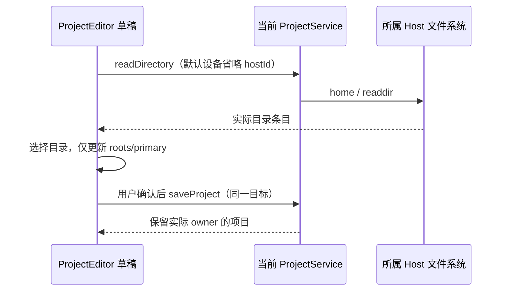

# 本地项目使用系统多目录选择器

## 行为与归属

桌面创建本地项目、编辑本地项目的「添加文件夹」使用操作系统原生目录选择框，允许一次多选目录。沿用平台接口的 native dialog 能力，新增可选 `IPlatformService.selectDirectories(): Promise<string[]>`；Electron main 使用 `openDirectory`、`createDirectory`、`multiSelections`，返回全部路径，取消返回空数组。旧 `selectDirectory` 单选契约不变。

ProjectEditor 仍是名称、roots、primary 的唯一草稿 owner；多选结果按返回顺序追加并去重。原 roots 为空时第一个目录成为主目录，否则保留现有主目录。选择操作不创建项目、不打开 workspace 或启动 Agent，仅显式保存才调用原 `saveProject`。

```text
桌面 + 本地 Host → 平台 selectDirectories → preload IPC → main 原生多选
                                                         ↓ 全部路径 / []
                                                ProjectEditor 草稿
                                                         ↓ 显式保存
                                                   Host saveProject
远端 / Web / 手机 → 原 projectService.readDirectory(hostId) → 同一草稿
```

## 边界与失败语义

- 仅 `hostId` 未指定或为 `local`，且平台提供 `selectDirectories` 时使用系统选择器；判定不依赖当前 tab/cwd。远端项目继续浏览所属 Host，Web/手机未提供该能力，不能选择浏览器所在设备的目录作为 Host root。
- 原生选择在途期间禁用编辑、保存、删除和关闭，避免异步返回与草稿修改交错；选择完成后再合并一次。组件卸载后的结果不能触发持久化或重新打开编辑器。
- 取消不修改草稿；调用失败显示原错误区域、保留草稿并允许重试，不自动切换到另一选择方式。
- 目录选择不改变 Host 组织态、workspaceIdentity、owner/lease、桌面 continuous 或手机 replayable 语义；无数据库/CLI 协议迁移。
- 明暗主题沿用原编辑器，系统弹窗由操作系统渲染；macOS、Windows、Linux 共用 Electron 原生目录选项。

## Web 创建项目的当前服务目录

创建表单默认设备项 `local` 表示当前项目服务，不保证其实际 Host ID 为 `local`。
独立 Web 连接的 Source Server 使用自己的非 `local` owner；默认创建的 home、目录读取和
所选 root 的 `saveProject` 请求均省略 `hostId`，由现有项目服务路由到自身。不能把浏览器
所在设备当作目录 owner，也不能通过忽略错误、放宽服务端 Host 检查或提升系统权限修复。

仅将创建表单的默认设备转换为服务相对请求；已选外部设备、固定目录和已有项目的显式
Host 保持原样。桌面默认设备仍使用原生多选，Web/手机仍使用应用内目录浏览器。
保存返回的实际 Source Host ID 不代表用户选择了外部设备；只有显式跨 Host 创建才登记
控制端项目入口。此处只修目录选择及其直接提交，不改项目打开、聊天交接或连接生命周期。

ProjectEditor 继续独占 roots/primary 草稿，取消或选择目录不持久化；显式信任确认后才
提交所选路径。请求序号、卸载失效、真实文件权限及 Source 的单目录约束保持不变。



聚焦浏览器回归：`packages/web/test/e2e/source/project-directory-picker.mjs`。
从仓库根目录运行 `pnpm exec tsx packages/web/test/e2e/source/project-directory-picker.mjs`；
用例自行创建隔离 SQLite、真实文件目录、普通 HTTP `/ws` 和浏览器，不读取用户 profile
或启动 Agent，结束后关闭自身进程并清理临时数据。
已有 Edge 而未安装 Chrome 的环境可设置 `PLAYWRIGHT_CHROMIUM_CHANNEL=msedge`；
浏览器使用独立临时 profile，全部 listener 仅绑定动态 loopback 端口。

| 用例  | 操作与断言                                                                                                                                                                               |
| ----- | ---------------------------------------------------------------------------------------------------------------------------------------------------------------------------------------- |
| SDP01 | 普通 Source `/ws` 创建项目，默认设备读取 Source home，输入真实允许路径，展示子目录并确认；root 回到表单，选择/取消不写库，显式确认后可保存                                               |
| SDP02 | 默认当前服务为 `local` 时仍读取其目录；显式选择外部 Host 时 home、目录读取、保存及入口登记保留该 Host，不回落到当前服务；入口登记失败重试保留原目标与项目 ID，只保存一次、不再次确认信任 |
| SDP03 | 相同可读路径的错误显式 Host 在文件 IO 前拒绝；不存在目录仍显示错误、禁用确认，并可重新输入有效路径恢复                                                                                   |

回归覆盖 1024/390 宽度、Zai 明暗主题与中英文。普通 HTTP/RPC 与文件 IO 在执行环境中
实际运行；Windows 上的结果不作为 Linux/fnOS ACL、挂载或系统原生窗口的实测证据。

### 创建目录聚焦修复验证（2026-11-14）

- Windows + 独立 Edge：SDP01–03 通过。八个 Source 场景（1024/390 × 明暗 × zh-CN/en-US）、
  本地默认当前服务与显式外部 Host 创建，共十个创建流程通过；普通 `/ws` 的错误显式 Host
  仍在文件 IO 前拒绝。
- 使用真实目录、文件 IO 和隔离 SQLite；验证选择/取消不落盘、信任取消不保存、确认后保存
  一次并刷新关闭、默认请求省略 Host、外部请求保留 Host、入口登记失败重试复用原项目。
  真实 ENOENT 仍显示错误并禁用确认，重新输入有效路径可恢复；目录面板视口内几何断言与
  1024 明/390 暗截图检查通过，全部场景无 page error。
- 新浏览器夹具按 Web 编译选项、既有 env 声明和包工程引用单独执行 TypeScript 静态检查
  通过（no emit）；根 Web tsconfig 不包含此测试文件，不能以 Vite 编译代替类型检查。
- `pnpm lint`：0 errors / 540 warnings。聚焦五个文件为 0 errors / 1 既有 Hooks 告警；
  告警是编辑器卸载时递增 `epoch.current`，人工复核其为请求失效计数器而非 DOM ref，
  保留原卸载失效行为，本次无新增依赖或 Hook 调用位置诊断。
- 六个本次文件格式检查通过；`pnpm architecture:check --changed`：0 violations / 0 new。
  `pnpm typecheck` 未通过：首次 Node heap OOM，命令进程级增加 heap 后被未改动的
  [凭据 E2E 夹具](../../packages/desktop/test/e2e/fixtures/credential-recovery/server-websocket.ts)
  漏 `await createHttpServer` 的四项既有错误阻塞；未修改该文件，未将全库类型检查标为通过。
- 本次未验证 Linux/fnOS ACL、挂载、Electron 原生窗口或真实手机；未修改凭据、项目打开、
  历史导航、预览或连接生命周期。

## 验收用例（accepted / pending）

| 用例  | 操作与断言                                                                                                                  |
| ----- | --------------------------------------------------------------------------------------------------------------------------- |
| NDP01 | 桌面本地点击添加，一次选择两个真实目录；原生参数包含多选，不出现应用内目录浏览器；保存后重新编辑仍有两目录                  |
| NDP02 | 追加含已有目录的多选结果，只追加新目录并保留原主目录；取消选择不变更目录；取消编辑不保存                                    |
| NDP03 | 原生选择在途时禁止保存/关闭，失败后草稿保留且可重试；远端 Host 即使具备原生能力也使用 Host 浏览；Web/手机无原生能力仍可浏览 |
| NDP04 | 原有单选仍返回一个路径或 null；多选取消返回 []；明暗编辑器可用                                                              |

Electron 交互用例：`packages/desktop/test/e2e/workspace/projects/project-native-directory-picker.test.ts`。mock 仅替代系统弹窗的用户返回值，真实执行 UI → preload → main、保存与重新编辑；不声称覆盖操作系统原生窗口内的鼠标多选。单测覆盖 Host/平台边界及失败/在途状态。既有本地目录浏览 E2E 同步改用原生弹窗 mock。真实手机连接与 Windows/Linux GUI 需另行验证。

## 验证记录（2026-09-15）

- 相关单测 5 文件 / 21 项通过；`pnpm typecheck`、desktop `typecheck:e2e` 通过；`pnpm lint` 0 errors / 47 既有 warnings。
- Electron：`desktop-e2e-20260915125744659-p84856-08e67d2dd0407c35`，2/2 通过，包含 NDP01/NDP02、既有 WCP01 删除后重启回归及明暗截图。
- `architecture:check --changed --base HEAD` 为 0 violations；默认 staging 基线检查仍有开工前已存在的 `packages/ui/src/root/resolveConversationWorkspaceTarget.ts` unmanaged-new-file，未新增违规。
- 未运行真实手机配对、SSH/WSL Host、Windows/Linux GUI 或原生弹窗内手动多选；这些边界不以桌面弹窗 mock 代替实测。
