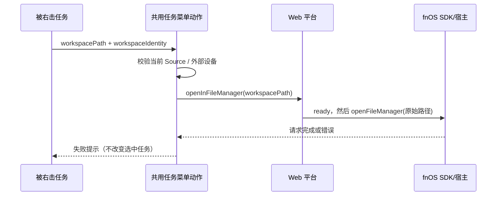

# Web 平台适配

`createWebPlatform` 是普通 Web 和手机远控共用的 IPlatformService 实现。平台代理仍只路由原有获准操作；文件保存始终发生在当前浏览器，不把远端文件路径传给桌面下载器。

- `saveFile` 接收原始 ArrayBuffer 或 URL 读取结果，最多 50 MiB，允许空文件。
- URL 内容按流读取并检查实际字节数；异常停止读取。只接受 HTTP、HTTPS、data、blob 来源。
- 下载文件名清理路径和非法字符；触发后移除临时链接并回收 Blob URL。
- success 只表示交付给浏览器下载，不能视为用户已确认或文件已落盘。取消下载无法被页面可靠观察。
- 此模块不持有工作区、任务、session 或 stream 状态；现有远控连接、事件和 owner 语义保持不变。

## fnOS 文件管理器

- 普通 Web 仅对 `openInFileManager(path, "workspace")` 使用官方 `@trimjs/web-app` 的 `TrimApp.openFileManager(path)`；配置文件等其他调用不启用 NAS 路由。等待 SDK ready 后确认宿主环境，独立浏览器返回明确不支持，手机远控代理不调用当前 NAS 的 SDK。
- fnOS 应用包必须声明 `micro_app=true`，系统至少 1.2.0401，移动 App 至少 1.34.0。应用包不在本仓库中，部署方需满足此条件。
- 路径来自用户右击的任务 `workspacePath`（包含 worktree 和无项目任务），不使用当前选中任务、项目首个 root、identity 或会话日志路径。按原字符串交付 SDK，不拼 URL、不做双重编码。
- 当前 Source identity 通过现有 `isDirectSourceWorkspace` 校验后使用带 `workspace` scope 的平台入口；该 scope 仅由任务目录动作使用，配置文件回退等其他文件管理器调用不变。其他设备保留 WSL 精确映射和 SSH/Docker 拒绝规则。路径来自已有任务可访问范围；路由不授予权限，也不绕过 NAS 当前用户权限。
- SDK 初始化、路由拒绝和不支持必须返回失败，任务菜单记录日志并提示用户；成功仅表示宿主接受路由请求，不保证文件管理器最终呈现或目录存在。

### 验收场景

| 场景 | 断言 |
| --- | --- |
| 项目、分组、置顶、归档中的任务 | 共用动作传入该行 workspacePath，不受当前活动任务影响 |
| 中文、空格、#、% 的路径；worktree；无项目草稿 | SDK 接收原路径一次，不改写为父目录或项目 root |
| 当前 Source 带 identity | 允许 NAS 路由，不误判成 SSH；其他 Source 即使路径相同也禁止 |
| 独立浏览器、SDK 拒绝/初始化失败、手机远控 | 返回明确失败；不产生成功结果或错误设备上的路由 |
| Windows/macOS/Linux 桌面与 WSL | 保持原有本机/UNC 行为 |

浏览器回归：`node --test packages/ui/test/browser/manual-review/pending/fnos-file-manager.test.mjs`。使用真实 SDK 和模拟移动宿主检查原始路径、独立浏览器拒绝和错误传播；通过 `BROWSER_CHANNEL` 选择浏览器（默认 Edge）。真实 NAS 窗口呈现需要部署环境验收。
